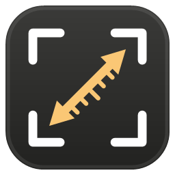

# SnapMeasure 1.3

Portable screenshot and **quantity takeoff** tool: **dimensions, areas with cut-outs, path lengths, perimeters, angles, counts,
drawing scales**, mark-up (clouds, stamps, text markup, notes), **PDF pages**, **OCR** and **scrolling capture**,
plus an **on-screen ruler and protractor** that float over any app.
One file, `SnapMeasure.exe` (~400 KB). No installer, no admin rights. It runs on any Windows 10/11 PC
(it uses the .NET Framework 4.x, the PDF reader and the text recognition that are built into Windows).
**Download:** install it from the [Microsoft Store](https://apps.microsoft.com/detail/9pgk12tn6wqj?mode=direct) (signed, updates
itself, no "Windows protected your PC" warning), take `SnapMeasure.exe` (or the portable zip) from the [Releases](../../releases)
page, or build it yourself (see below).
Free and open source under the [MIT licence](LICENSE). Made by **sARATH**.

**What's new in 1.3:**
* **Radius / diameter** (`Shift+R`): click 3 points on a curve or circle → R, Ø and the arc length (R1, R2 … in Excel).
  **Show** radius, diameter or both; the label can be moved and resized like an area label.
* **Area and perimeter in one tool** (`M`): **Show** area + perimeter, area only or perimeter only. `Q` opens it set to
  perimeter only (P1, P2 …); cut-outs still work. `W` stays for open lengths. Files from 1.2 open unchanged.
* **Match properties** (`Ctrl+Shift+M`, brush under TOOLS): select a shape, then click other shapes to give them its colours,
  opacity, line width and style, text size and style, line ends and shadow (never its text or points). `Esc` or right-click ends it.
* **Zoom to area** (`Shift+Z`, button next to *Fit*): drag a box and the view zooms to it.
* **Add-ons ▾** in the top bar opens the on-screen ruler and protractor straight from the editor.
* **Side scrolling:** the tilt / thumb wheel (e.g. Logitech MX) and `Shift`+wheel pan left and right.
* **Arc** (`Shift+L`): a drawing tool – start, a point on the arc, end.
* **Polyline** (`Shift+P`, next to Polygon): an open line through any number of points, with optional arrowheads (tick **Closed** for a polygon).
* **Highlighter pen** (`Shift+H`): a see-through yellow marker you drag over text; hold `Shift` for a straight stroke
  (line width up to 200 for large text).
* **Focus** (`H`, was Highlight): spotlight, grayscale, magnify or pixelate; grayscale and pixelate work **inside or outside** the shape. The yellow marker mode is now the highlighter pen.
  A **Strength** slider sets how much magnify enlarges (×1.5 … ×6) and how coarse pixelate is (4 … 40 px blocks).
* **Tool column in order of work:** Measure (calibrate first), Count, Draw (lines, then shapes), Highlight, Text, Tools.
  It stays one column: on a short window or a large display scale the group titles become thin dividers, and if it still
  does not fit, the column scrolls with the mouse wheel.
* **Keep inside** (lock button next to *Zoom to area*, `Ctrl+L`): drawing, moving, pasting, resizing and turning all stay
  inside the screenshot (or its crop), and the view no longer scrolls past the picture. Nothing is moved: whatever lies outside
  the picture is hidden until you unlock. Off by default; *Settings → General* sets whether new editors start locked.
* **Area tool** (`M`) always measures a closed area; use **Length** (`W`) for an open run.
* **Pin: rotate and mirror** – right-click → *Rotate / mirror*, or `R` / `Shift+R` (rotate right / left), `H` (mirror), `V` (flip).
* **Revision clouds can be rotated** (green knob) when they have no callout. A **polygon or area with a cloud outline** is filled
  right out to its scallops.
* **Strike-out** is as heavy as the letters (heavier for bold), not a hairline.
* **Smoother drawing:** the rulers and the magnifier no longer redraw the whole picture on every mouse move.
* **Marker labels stay on one line:** long numbers (1012) and double letters (BM, ABM) shrink to fit the circle.
* **Safer saving:** pictures and projects are written to a temporary file and swapped in, so a failed save never spoils the old file.
  Unexpected errors are written to `%TEMP%\SnapMeasure-error.log` and the editor stays open so you can save.
* **Magnifier** at the pointer for every measuring tool, and while you drag a point of a measurement, so points land exactly on the lines.
* **Text boxes have 8 handles**: corners and sides resize the box, the text wraps inside and keeps its size.
  **Line width is the frame:** 0 = no frame, any other width draws it. New **U** (underline) and **S** (strike out) buttons.
* **Area and perimeter labels** can be moved (yellow knob) and resized (corner handle); a dotted line joins them to the shape.
* **Handles show which way they stretch** (↔ ↕ ⤡ ⤢).
* **Captured mouse pointer** (Settings → Capture) arrives as a separate picture on top: move it, or press Delete to remove it.
* **Freehand arrowheads** now point along the end of the stroke. **Cloud** line style is offered only for closed shapes.
* **Texts list** in the right panel: every text, speech bubble, cloud callout and stamp in one place. Click a line to select it,
  click again or press `F2` to edit it there (`↵` = new line). **Copy all text** puts them all on the clipboard.
* **Settings → General:** choose your own **capture keys** (two per capture) and the **tool icon size** (small, medium, large).
* **Tidier top row:** *New capture ▾* (blank canvas), *Save ▾* (save as), *Copy ▾* (picture, text, measurements), *Adjust ▾* (rotate,
  mirror, effects), *View ▾* (1:1, rulers) and **Add-ons ▾** (on-screen ruler and protractor). **Panel, Pin and Settings** sit at the right end.
* **Simpler status bar:** one short sentence for the next step.
* **Shadows** fall only under lines and shapes, not under value boxes or labels.
* The **Text markup** tool (`Y`) is gone: use the highlighter pen or a line. Markups in older files still show.
* **Guides are magenta**, so they stand out from blue and cyan drawings. **Focus** always starts as a rectangle.
* **Pin** minimizes the editor; in the pin, `Ctrl+P`, `Esc` or a double-click unpins and brings the editor back.

**What's fixed in 1.2.1** (same features as 1.2):
* A 2-point **open path** and a **custom stamp** are no longer lost or changed when you save or copy-paste them.
* **W** starts a length (open path) and **Q** a closed perimeter, as documented; the live readout shows *Total* for an open path.
* The capture delay no longer freezes SnapMeasure while it counts down.
* A busy clipboard (another program holding it) shows a message instead of an error – also for copy picture, copy text and copy measurements in the editor.
* Settings are saved safely when several SnapMeasure windows are open; *Open folder* works with a folder ending in `\`.
* The magnifier stays on screen in corners and near the edge when monitors have different sizes.
* Long sessions use less memory: undo pictures, fonts, menu icons, effect caches and PDF / text-recognition resources are freed when no longer needed.
* **New app icon:** white capture-frame corners with an amber measuring arrow on a dark rounded square
  (ruler ticks on the larger sizes). Look for it in the system tray.

**What's new in 1.2:**
* **Settings window** with three tabs: **Capture** (what PrtSc does – open the editor, only copy, only save, or copy + save;
  mouse pointer; camera sound; notifications; magnifier; delay; editor window matches the capture size), **Output** and **About** (version, GitHub, check for updates, shortcuts).
* **Coordinates** (`I`): the first click sets the origin 0,0; every point then shows X / Y with **Y up, like CAD**.
  Drag the origin (or right-click a point → *Make this point the origin*) and every value updates. X and Y go to Excel.
* **Line styles** for all outlines: solid, dashed, dotted, dash-dot, long dash and **cloud** (scalloped rectangles, ellipses, polygons).
* **Revision cloud callouts:** a **revision triangle** with a number, or a **text box**, on a leader. Drag the yellow handle to move it.
* **Stamps:** type straight onto the stamp (no pop-up) and more stamp types (Draft, Final, For comment, For construction,
  Not approved, Checked, As built, Confidential, Void, Expired, Sold … 21 in all, plus Custom) with a **date format** choice
  (2026-11-19, 19/11/2026, 11/19/2026, long date, or no date).
* **Text:** drag a **text box** to set its width (the text wraps), side handles to resize it, an optional **frame** in the line
  colour and width, and **Esc keeps your text**.
* **Length / perimeter** is open by default; tick **Closed** for a perimeter.
* **Freehand** can have arrowheads (any of the 10 line ends).
* **Highlight** now includes **Pixelate**, and every highlight can be a rectangle, ellipse, triangle, diamond or rounded box.
* **Status bar guide:** tells you the next step for the tool you have (step 1, step 2 …) and what you can do with the selection.
* **Closing:** clear buttons – *Save…*, *Close without saving*, *Keep editing*.
* **Tool bar** grouped under headings: Measure, Count, Mark-up, Text, Tools.

**What came in 1.1:**
* **Quantities:** area **minus cut-outs** (gross / cut-outs / net), **path length** (sealant runs, gaskets), **perimeter**,
  **counts** per marker series, and **labels** on every measurement. *Copy measurements* puts all of it into Excel.
* **Drawing scales:** 1:50 on an A1 sheet, 1:100 at 300 dpi, the exact size of a PDF page, or scales you save yourself.
* **Open PDF pages** directly (Windows' own PDF reader) – the paper size makes the scale exact.
* **Mark-up:** 10 line ends for arrows, lines and dimensions (right-click), **revision cloud**, **stamps**
  (Approved / Revise / For information / Rejected / custom, with date), **text markup** (underline, strike out, highlight –
  snaps to the words), and **notes** that are shown in the editor but never printed.
* **OCR:** copy text out of a picture or straight off the screen (`Ctrl+Shift+6`).
* **Scrolling capture** of long pages (`Ctrl+Shift+5`).
* **Check for updates** in the About window (only when you click it).
* Fixes from 1.0.1: right-sized icons, text and menus on every monitor (mixed 100 % / 200 % screens);
  the ruler's *Set scale* box opens beside the ruler, and its right-click menu also works straight after a drag.

**Highlights:**
* Measuring: dimensions, areas with cut-outs, path length, perimeter, 3-point angle, counts, scale calibration and presets,
  rulers & guides, Excel export with labels.
* Annotating: a style bar above the canvas, arrows and lines with 10 end styles, text, speech bubbles, clouds, stamps,
  text markup, notes, markers, highlights, pixelate, and pasted pictures.
* Helpers: adjustable crop, a blank canvas, a pin you can resize and crop, and an on-screen ruler (calibratable) and protractor.
* **Ctrl+S** saves the picture **and** an editable `.snapm` project, named like Greenshot after the app you captured
  (e.g. `2026-11-18 11_34_09-Autodesk AutoCAD LT 2026 - [plan.dwg].png`).
  The folder, file name pattern, format and quality are under **Settings**.
* Export formats: **PNG, JPG, BMP, GIF, TIFF, PDF, ICO**, plus `.snapm` (stays editable).

## Run it
Double-click `SnapMeasure.exe`. It sits in the system tray (bottom-right).
Settings are saved in `SnapMeasure.ini` **next to the exe**, so you can carry it on a USB stick.
To have it ready after every restart, tick **Start with Windows** in the tray menu (right-click the tray icon).
In the Store version Windows asks once; you can also switch it in *Windows Settings → Apps → Startup*.

| Capture | Keys |
|---|---|
| Region, or click a window | `PrtSc` or `Ctrl+Shift+1` (or left-click the tray icon) |
| Active window | `Alt+PrtSc` or `Ctrl+Shift+2` |
| Screen under mouse | `Ctrl+PrtSc` or `Ctrl+Shift+3` |
| Last region again | `Shift+PrtSc` or `Ctrl+Shift+4` |
| **Scrolling capture** (long page): pick the area, SnapMeasure scrolls it and joins the pieces. Move the mouse to pause; **Stop** (bar under the area) or `Esc` finishes | `Ctrl+Shift+5` |
| **Capture text (OCR)**: pick an area, its text goes to the clipboard | `Ctrl+Shift+6` |

These are the default keys. Choose your own in **Settings → General** (click a box and press the keys; two per capture).

**PDF drawings:** *Open…* (editor or tray) also opens PDFs. Pick the page and the sharpness (100–300 dpi);
SnapMeasure remembers the page's real paper size, so *Drawing scale → PDF page (exact)* gives the right scale straight away.

If Windows Snipping Tool owns `PrtSc`, SnapMeasure says so at start-up. Use the `Ctrl+Shift` keys or your own keys instead,
or turn off *Settings → Accessibility → Keyboard → "Use the Print screen key to open screen capture"*.

## On-screen ruler & protractor (work over any app: PDF, CAD, browser …)
Open them from the tray menu or **Add-ons ▾ → On-screen ruler / On-screen protractor** in the editor's top bar.
* **Calibrate the ruler to real units:** put the red circle on one end of a known dimension (e.g. a 160 mm CAD dimension)
  and drag the **red marker** to the other end. Then right-click → *Calibrate: red marker = real length…* and type the length.
  The ticks and the readout switch to mm, cm, m, in or ft, and the scale is remembered.
  Right-click also has *Set scale (1 px = …)* and *Reset to pixels*.
* **Ruler:** drag it to move it. Drag the **green knob** to rotate it about the red pivot; `Shift` gives 15° steps.
  The mouse wheel turns it 1° at a time (`Ctrl` = 0.1°). Drag the far end to change the length.
  It always shows its angle and its length in px. Right-click for 0° / 90°, *Set angle…* and preset lengths.
* **Protractor:** drag the **blue** and **red** knobs onto the two edges you want to measure.
  It shows the angle between them plus the inside and other-side angles. Drag anywhere else to move it; the mouse wheel changes its size.
* The arrow keys nudge either tool and `Esc` closes it. In the tray menu, *Close rulers & protractors* closes them all.

## Editor tools
| Tool | Key | What it does |
|---|---|---|
| Dimension | `D` | CAD-style dimension: solid arrowheads that grow with the line width, end ticks, and the value **in the middle of the line**. Drag the yellow handle to offset it. Double-click to add a prefix. |
| Area / perimeter | `M` | Click corners → label with area + perimeter, area only, perimeter only or none (**Show** on the style bar) (A1, A2 …). Always closed. |
| Cut-out | `X` | Click the corners of an opening **inside an area** → it is subtracted: the label shows gross, cut-outs and **net** area. Inside a **polygon** it makes a hollow (e.g. a hollow steel section). |
| Path length | `W` | Click points along a run (sealant, gasket, coping) → total length (L1, L2 …). Tick **Closed** for a closed perimeter. |
| Perimeter | `Q` | The area tool set to perimeter only (P1, P2 …) |
| Coordinates | `I` | The first click sets the origin 0,0; every point after it shows X / Y (**Y up, like CAD**). Drag the origin, or right-click a point → *Make this point the origin*, and every value updates. X and Y go to Excel. |
| Angle | `G` | **3 points:** end of the first arm → vertex → end of the second arm. Shows the angle (∠1, ∠2 …); also listed under Measurements. |
| Radius / diameter | `Shift+R` | **3 points** on a curve or circle edge → R, Ø and arc length (R1, R2 …), with a centre mark. **Show** R, Ø or both; the label can be moved. Listed under Measurements and in Excel. |
| Calibrate | `K` | Draw over a known length, type its real size → sets the scale factor |
| Number marker | `N` | 1, 2, 3 … renumbers itself when one is deleted – **the count is listed** (Σ1 = 14 nr) |
| Letter marker | `Shift+N` | A, B, C … Z, AA, AB … is **its own series**, separate from the numbers, also counted |
| Polygon | `P` | Any number of edges, with fill colour and opacity. |
| Polyline | `Shift+P` | Open line through any number of points; arrowheads optional. Tick **Closed** to make it a polygon. |
| Focus | `H` | Spotlight, grayscale, magnify, **pixelate** (`B`) – grayscale and pixelate inside or outside, **Strength** slider for magnify (×1.5 … ×6) and pixelate (4 … 40 px) – as a rectangle (always the start), ellipse, triangle, diamond or rounded box |
| Highlighter pen | `Shift+H` | Drag over text like a marker pen: see-through yellow, square ends. `Shift` = straight stroke. Colour, width and opacity on the style bar. |
| Rectangle / Ellipse | `R` `E` | Fill and line colour, each with its own opacity. The centre mark snaps to points. |
| Revision cloud | `U` | Drag a cloud around a change; the line width sets the size of the scallops. **Callout:** none, revision triangle (number) or text box, on a leader |
| Line / Arrow / Freehand | `L` `A` `F` | **10 line ends** (none, filled / open / hollow arrow, slash, tick, dot, circle, diamond, square) for the start and the end |
| Arc | `Shift+L` | 3 points: start, a point on the arc, end |
| Text | `T` | Click and type, or **drag a box** (the text wraps; the **8 handles** resize the box). Bold, italic, underline, strike out and alignment on the style bar; **line width = frame** (0 = none). `Esc` keeps the text. Every text is also listed under **Texts** on the right, where you can edit it. |
| Speech bubble | `S` | Drag or click, then type. Bold / italic / alignment as for Text. Drag the yellow handle to point the tail. |
| Stamp | `Z` | Click to place APPROVED, REVISE, FOR INFORMATION, REJECTED, DRAFT, FINAL, FOR COMMENT, FOR CONSTRUCTION, NOT APPROVED, CHECKED, AS BUILT, CONFIDENTIAL, VOID, EXPIRED, SOLD, TOP SECRET … or your own words, with the date in the format you pick on the style bar. **Double-click and type straight onto it.** |
| Note | `O` | A sticky note shown in the editor only – **left out of saved, copied and pinned pictures** (listed in the Excel export) |
| Copy text (OCR) | `Shift+T` | Drag over text to copy it; a click copies all the text. The **Copy text** button copies the whole picture. |
| Pixelate | `B` | Hide sensitive information |
| Crop | `C` | **Adjustable crop** (see below) |

**Line ends:** right-click a line, arrow or dimension → *Start head* / *End head* (with pictures), or *Swap start / end heads*.
The same choices are on the style bar.

**Labels and counts:** double-click a measurement to label it (e.g. *Spandrel L01*), or a marker to say what its series counts
(e.g. *Blind panel*). Double-clicking a row in the list on the right does the same.
*Copy measurements (for Excel)* gives one row per item: Name, Type, Value, Unit, Perimeter, Gross, Cut-outs, Label, X, Y –
including the marker counts and the notes.

**Markers:** *Start at* (style bar) continues a series. Changing the colour, size or shadow of one marker
changes **every marker in that series**.

**Style bar** (right above the canvas): line colour, opacity and width; fill colour and opacity; text size; B / I / alignment;
start / end line ends; highlight, text-markup and stamp type; marker *Start at*; shadow; and a quick palette.
In the palette, click a colour for the line and right-click it for the fill.
**View ▾ → Scale & measurements panel** (or `F4`) shows or hides the panel on the right: scale, measurements & counts, and texts.

**Colour keys:**
* `Alt+L` = pick the line colour, `Alt+F` = pick the fill colour.
* `Alt+1`…`Alt+9` = line colour from the palette (red, orange, yellow, green, blue, purple, black, white, grey).
* `Alt+Shift+1`…`9` = the same colours for the fill. `Alt+Shift+0` = no fill.

**Pictures:** `Ctrl+V` pastes a copied picture (or a copied image file) onto the canvas. You can also drag image files onto the editor.
Drag it to move it, drag a corner to scale it (proportions are kept; `Shift` = free), or use the green knob to rotate it.
*Fill opacity* sets how see-through the picture is.

**Blank canvas:** the **Blank** button or the tray menu opens a new canvas: screen size, Full HD, A4 or custom,
on white, grid paper, transparent or black.

## Selecting, copy / paste and draw order
* Click to select. **Shift+click** or **drag a box** selects several shapes; `Ctrl+A` selects all.
* **Right-click** gives Cut, Copy, Paste here, Duplicate, Delete, Bring to front, Bring forward, Send backward, Send to back,
  Select all, Remove crop and Clear guides.
* `Ctrl+C` / `Ctrl+X` / `Ctrl+V` copy, cut and paste **shapes**, even into another editor window. `Ctrl+D` duplicates.
  With nothing selected, `Ctrl+C` copies the whole image.
* Draw order: `Ctrl+]` brings a shape forward, `Ctrl+[` sends it backward. Add `Shift` for front / back.
* Drag the **green knob** to rotate, the 8 white handles to resize, or the **centre mark** to move by the centre.

## Crop (adjustable)
Press `C` and drag the area to keep. Drag the handles or the frame to adjust it, and press `Enter` when done.
Anything outside the crop is hidden and is not saved in the image. Pick Crop again at any time to change it.
To undo it, press `Ctrl+Z`; to remove it, press `Delete` in Crop mode or right-click → *Remove crop*.
Border, drop shadow and torn edge apply to the cropped picture.

## Rulers & guides
Rulers run along the top and left. They read in your scale units (px, mm, m …), and a red mark follows the mouse.
**Drag from a ruler** to place a guide; points snap to guides.
Guides are magenta. Drag a guide to move it, or drag it back onto the ruler to delete it. `Ctrl+R` or **View ▾ → Rulers** shows or hides the rulers.

## Image menus and view
* **Rotate:** right / left 90°, mirror horizontal / vertical. Annotations, the crop and measurements follow.
* **Effects:** border, drop shadow, torn edge, grayscale, invert (`Ctrl+Z` to undo).
* `Home` (or `0`, or double-click the middle mouse button) fits and centres the image. `Ctrl+wheel` zooms; `Space`+drag pans; `Shift+Z` zooms to a box; `Shift`+wheel or the side wheel scrolls sideways.

**Scale:** set the unit and *1 pixel = …* in the right panel, calibrate from a known length (`K`), or use
**Drawing scale…**: 1:N with the picture's resolution (e.g. 1:100 at 300 dpi), the sheet it shows (e.g. 1:50 on A1 landscape),
or the exact size of a PDF page. Scales you use often can be saved by name and picked again.
The **Measurements & counts** list → *Copy measurements* pastes straight into Excel.

**Save:** `Ctrl+S` saves to *Pictures\SnapMeasure* (or the folder you choose in **Settings**). `Ctrl+Shift+S` saves as PNG, JPG, BMP, GIF, TIFF, PDF or ICO,
or as **.snapm**, which stays fully editable and keeps the crop and guides.

**Pin** (`Ctrl+P`) keeps a copy of the image on top of other windows. You can:
* drag its edges or corners to resize it (it keeps its proportions);
* press `C` (or right-click → *Crop*) and drag the part to keep; right-click → *Undo crop* brings the rest back;
* rotate it 90° (`R`, `Shift+R`) or 180°, mirror it (`H`) or flip it upside down (`V`) – also under right-click → *Rotate / mirror*;
* set the size from 25 % to 200 %, change the opacity, and copy it.

## Security
* Project files and clipboard data are treated as untrusted:
  * no DTDs or external entities are read (XXE-safe);
  * damaged or unknown shapes are skipped;
  * numbers are range-checked;
  * images over 30 000 px or 250 MP are refused.
* DLLs are loaded only from System32, never from the exe's folder (DLL planting).
  The build uses ASLR (high-entropy), DEP and an asInvoker manifest, so no admin rights are needed.
* No telemetry and no installer. The only time SnapMeasure goes online is when you click *Check for updates* in the About window
  (it asks GitHub for the latest release number). Nothing is written outside the exe folder or the chosen save folder.
* PDF pages and text recognition use the components built into Windows 10/11; nothing is downloaded.

## Greenshot weak spots and what SnapMeasure does instead
| Greenshot | SnapMeasure |
|---|---|
| No measuring: no dimensions, area, angle or scale | Dimension, area/perimeter, 3-point angle, calibration, units, Excel export |
| No rulers, guides or protractor | Editor rulers with guides, plus a floating on-screen ruler and protractor |
| No polygon highlight | Polygon with any number of edges, editable vertices |
| Crop is final | Adjustable crop that can be removed later |
| Reported scaling bugs with mixed-DPI / multiple monitors | Per-monitor-DPI aware: captures in true physical pixels |
| Annotations flattened once exported | `.snapm` project keeps everything editable |
| Scrolling capture unreliable | Scrolls the window, lines the pieces up even when the app scrolls by fractions of a pixel, and keeps sticky headers and status bars once (even when they show a changing number) |
| No OCR built in | Copy text from pictures or the screen with Windows' own text recognition |

Not included (yet): upload plugins.

## Build from source
Run `build.cmd`. It uses `csc.exe` from `C:\Windows\Microsoft.NET\Framework64\v4.0.30319` and the Windows metadata in
`C:\Windows\System32\WinMetadata`, so nothing needs installing.
`SnapMeasure.exe --selftest <folder>` runs the 142 built-in checks.
The icon is drawn in code (`AppIcon.Render` in `src/App.cs`). After changing it, delete `app.ico` and run `build.cmd`:
it writes a new multi-size `app.ico` (16–256 px) and builds it into the exe. `docs/icon.png` is the 256 px picture used above.

## Licence
MIT – see [LICENSE](LICENSE). You can use, change and share SnapMeasure freely; keep the copyright notice.
