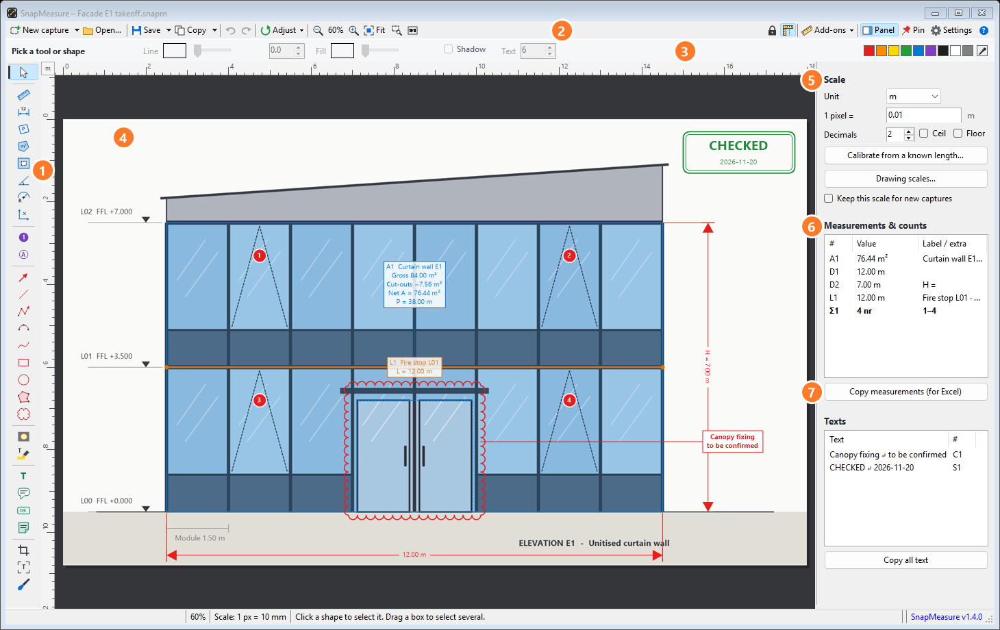

# SnapMeasure — Quick User Guide

For SnapMeasure 1.4.2 · [Trailer video (40 s)](SnapMeasure-trailer.mp4) · [Full feature list](../README.md)

## What SnapMeasure does

SnapMeasure turns anything on your screen into a measured take-off in three steps: **Snap** a picture, **Measure** it in real units, **Send** every value to Excel. It works on a PDF in any viewer, a drawing in AutoCAD or Revit, a web map or a photo, with no import or file conversion.

It is free, needs no account and sends nothing anywhere. Your pictures stay on your PC. It runs on Windows 10 and 11, in English or Korean (한국어).

## The editor at a glance

Every capture opens in this window. The numbers match the picture below.

1. **Tools**: measure, count, draw, highlight, text. Hover over an icon to see its name and key.
2. **Top bar**: new capture, open, save, copy, undo, zoom and fit.
3. **Style bar**: colour, line width, fill, text size and arrowheads for the tool you have.
4. **Picture**: click here to measure and mark up. The status bar at the bottom tells you the next click.
5. **Scale**: unit, 1 pixel = …, calibrate and drawing scales.
6. **Measurements & counts**: every value, updated live as you draw.
7. **Copy measurements (for Excel)**: the whole list in one click.

## Get started

Install it once, then press `PrtSc` whenever you want to measure something.

1. **Install** from the [Microsoft Store](https://apps.microsoft.com/detail/9pgk12tn6wqj?mode=direct) (search "SnapMeasure"; it updates itself). Or download `SnapMeasure.exe` from [GitHub Releases](https://github.com/sARATH-3D/SnapMeasure/releases) and double-click it: no installer, no admin rights.
2. **Find the tray icon** at the bottom right of the taskbar: a dark square with white corners and an amber arrow. SnapMeasure waits there.
3. **Start with Windows** (optional): right-click the tray icon and tick *Start with Windows*.
4. **If `PrtSc` opens the Windows Snipping Tool**, use `Ctrl+Shift+1` instead, or turn off *Windows Settings → Accessibility → Keyboard → Use the Print screen key to open screen capture*.

## Step 1 — Snap a picture

Press `PrtSc`, drag a box around what you want (or click a window), and the picture opens in the editor.

| To capture | Press |
| --- | --- |
| A region, or click a window | `PrtSc` or `Ctrl+Shift+1` |
| The active window | `Alt+PrtSc` or `Ctrl+Shift+2` |
| The whole screen under the mouse | `Ctrl+PrtSc` or `Ctrl+Shift+3` |
| The same region again | `Shift+PrtSc` or `Ctrl+Shift+4` |
| A long page that scrolls | `Ctrl+Shift+5`, then pick the area. SnapMeasure scrolls and joins the pieces; `Esc` or **Stop** ends it |
| Text only (OCR), copied to the clipboard | `Ctrl+Shift+T` or `Ctrl+Shift+6` |
| The picture already on the clipboard | `Ctrl+Shift+7` |

**PDF drawings:** right-click the tray icon → *Open…* and choose a PDF. Pick the page and the sharpness (100–300 dpi). SnapMeasure keeps the page's real paper size, so the scale can be exact (Step 2).

You can change every key in *Settings → General*.

## Step 2 — Set the scale

Set the scale before you measure, so every value comes out in real units (mm, m, ft) instead of pixels. The **Scale** box sits at the top of the panel on the right (`F4` shows or hides the panel). Pick one of three ways:

- **From a known length (most common):** press `K`, draw over something whose size you know (a dimension line, a door, a grid bay) and type its real length.
- **From the drawing scale:** click *Drawing scales…* and choose 1:N with the sheet size (for example 1:50 on A1) or with the resolution (1:100 at 300 dpi). For a PDF page, *PDF page (exact)* uses the true paper size. Save scales you use often by name.
- **Type it:** choose the unit and enter *1 pixel = …*.

Tick *Keep this scale for new captures* when you take several pictures of the same drawing at the same zoom.

## Step 3 — Measure

Pick a tool from the column on the left (or press its key), click the points, and the value appears on the drawing and in the *Measurements & counts* list on the right. A magnifier at the pointer helps you click exactly on the lines.

| Tool | Key | How to use it | You get |
| --- | --- | --- | --- |
| Dimension | `D` | Click the two ends; drag the yellow handle to move the line off the drawing | D1 = 12.00 m |
| Area | `M` | Click each corner; double-click (or `Enter`) to finish | A1 with area and perimeter |
| Cut-out | `X` | Click the corners of an opening inside an area | Gross, cut-outs and **net** area |
| Length | `W` | Click along a run (sealant, gasket, coping); double-click to finish | L1 total length |
| Perimeter | `Q` | Click the corners, like an area | P1 perimeter |
| Angle | `G` | Click arm end, corner, other arm end | ∠1 in degrees |
| Radius | `Shift+R` | Click 3 points on a curve | R, Ø and arc length |
| Count | `N` | Click each item; letters with `Shift+N` | Σ1 = 14 nr |
| Coordinates | `I` | First click = origin 0,0 (double-click it to give it other values); then click points | X / Y, Y up like CAD |
| Symbol | `Shift+M` | Click, then type or pick a symbol or short text | A mark such as Ø or "Type B-3"; it does not count up |

**Name what you measure:** double-click a measurement or a marker and type a label, for example *Spandrel L01* or *Blind panel*. Labels go to Excel with the values.

**Fix a point:** press `Esc` to return to Select, then drag any point. `Ctrl+Z` undoes.

## Step 4 — Mark up

Add notes for colleagues on the same picture; they are saved with it.

| To | Tool | Key |
| --- | --- | --- |
| Point at something | Arrow / Line | `A` / `L` |
| Write on the picture | Text (drag a box to wrap) | `T` |
| Add a comment with a tail | Speech bubble | `S` |
| Circle a change | Revision cloud | `U` |
| Mark approval | Stamp: Approved, Checked, For construction and 18 more, with the date | `Shift+Z` |
| Colour in an area | Fill (click inside a closed outline) | `Shift+F` |
| Highlight text | Highlighter pen | `Shift+H` |
| Hide private details | Pixelate | `B` |
| Leave a note only you see | Note (never printed or saved in the picture) | `O` |
| Copy text out of the picture | Copy text (OCR) | `Shift+T` |
| Keep only part of the picture | Crop (adjustable, `Enter` to apply) | `C` |

The style bar above the picture sets colour, line width, fill, text size and arrowheads. `Alt+1` … `Alt+9` pick a colour quickly.

## Step 5 — Send to Excel and save

One click copies every value; `Ctrl+S` keeps the work.

1. **To Excel:** click *Copy measurements (for Excel)* under the list on the right, then click a cell in Excel and press `Ctrl+V`. You get one row per item with Name, Type, Value, Unit, Perimeter, Gross, Cut-outs, Label, X and Y, plus the counts and notes.
2. **Save:** `Ctrl+S` saves the picture **and** an editable `.snapm` project to *Pictures\SnapMeasure*. Open the `.snapm` later to change any measurement.
3. **Save as another format:** `Ctrl+Shift+S` for PNG, JPG, PDF, TIFF, BMP, GIF or ICO.
4. **Share quickly:** with nothing selected, `Ctrl+C` copies the whole picture, ready to paste into an email or Teams.
5. **Keep it in view:** `Ctrl+P` pins the picture on top of other windows while you work.

## Keyboard shortcuts in the editor

| Key | Does |
| --- | --- |
| `Esc` | Drop the selection, back to Select |
| `Ctrl+Z` / `Ctrl+Y` | Undo / redo |
| `Backspace` while drawing | Remove the last point |
| `Shift` while drawing | Snap to level, plumb or 45° |
| `Home` or `0` | Fit the picture to the window |
| `Ctrl` + mouse wheel | Zoom |
| `Space` + drag | Pan |
| `Z` | Zoom to a box |
| `Ctrl+K` | Search tools and commands |
| `Ctrl+F` / `Ctrl+H` | Find / replace text in the drawing |
| `Ctrl+I` / `Ctrl+G` | Invert colours / grayscale |
| `F4` | Show or hide the scale and measurements panel |
| `Ctrl+R` | Show or hide the rulers (drag from a ruler for a guide) |
| `Ctrl+A`, `Ctrl+D` | Select all, duplicate |
| `Delete` | Delete the selection |
| `Ctrl+C` / `Ctrl+V` | Copy / paste shapes, even into another editor |
| `Ctrl+S` / `Ctrl+Shift+S` | Save / save as |
| `Ctrl+P` | Pin the picture on top |

## Tips, settings and privacy

- **Check the scale first.** Measure one dimension you already know; if it is off, recalibrate with `K` before taking off quantities.
- **Zoom in before you capture.** A sharper picture gives more exact clicks; for PDFs choose 200–300 dpi.
- **Measure over any app without capturing:** the on-screen ruler and protractor (tray menu, or *Add-ons* in the editor) float over PDFs, CAD and browsers. Right-click the ruler → *Calibrate* to read real units.
- **Settings** (gear button, or right-click the tray icon): capture keys, what `PrtSc` does (open the editor, copy, save), save folder and file names, light or dark theme, English or Korean.
- **Privacy:** no account, no ads, no tracking. Pictures stay on your PC. SnapMeasure goes online only when you click *Check for updates*.
- **Help and updates:** [github.com/sARATH-3D/SnapMeasure](https://github.com/sARATH-3D/SnapMeasure). Free and open source under the MIT licence.
